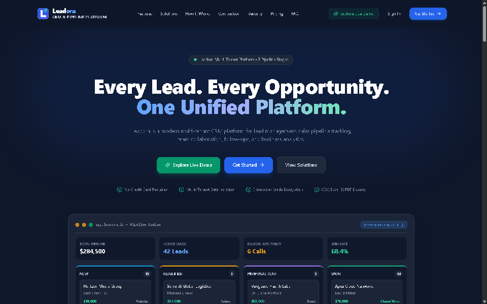
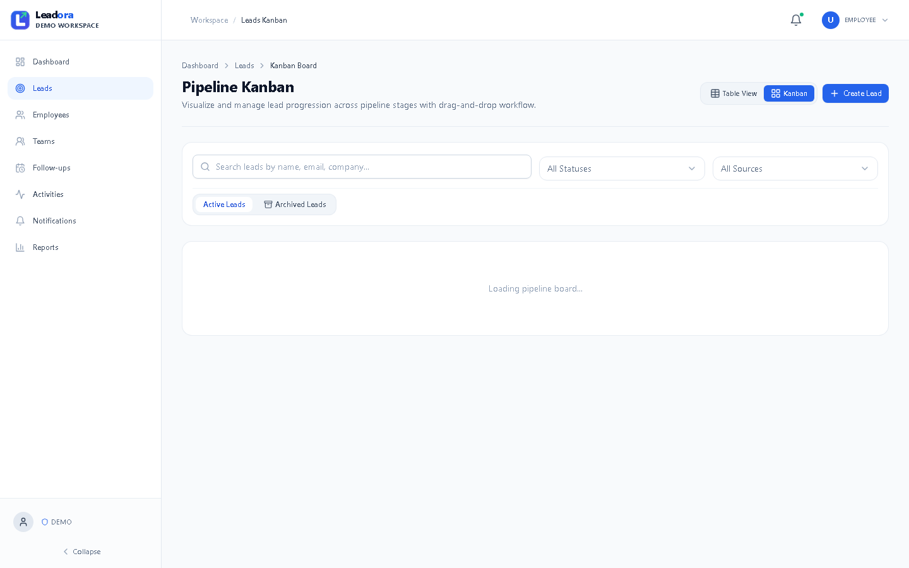
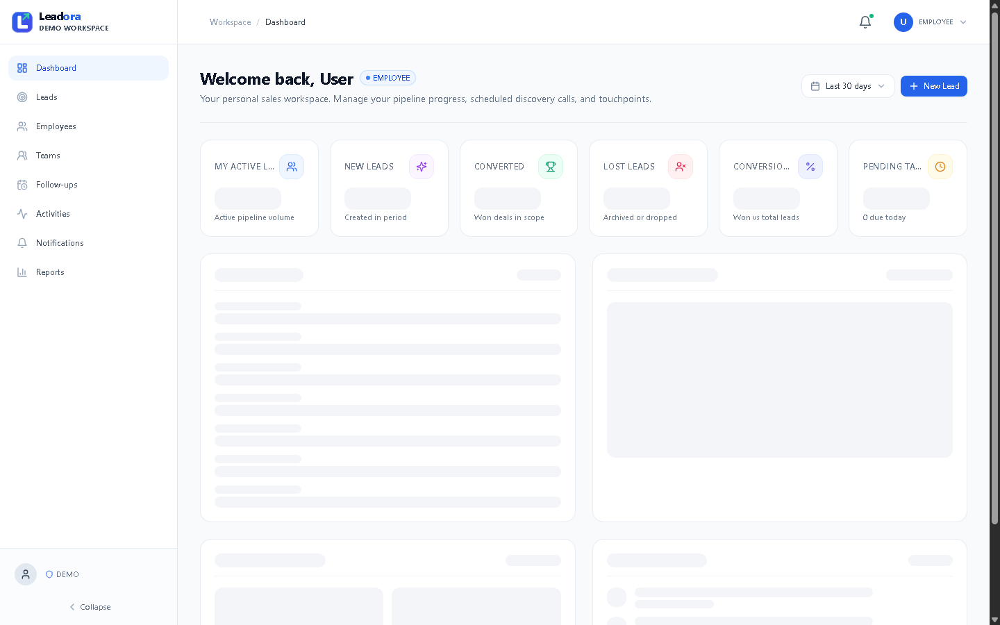
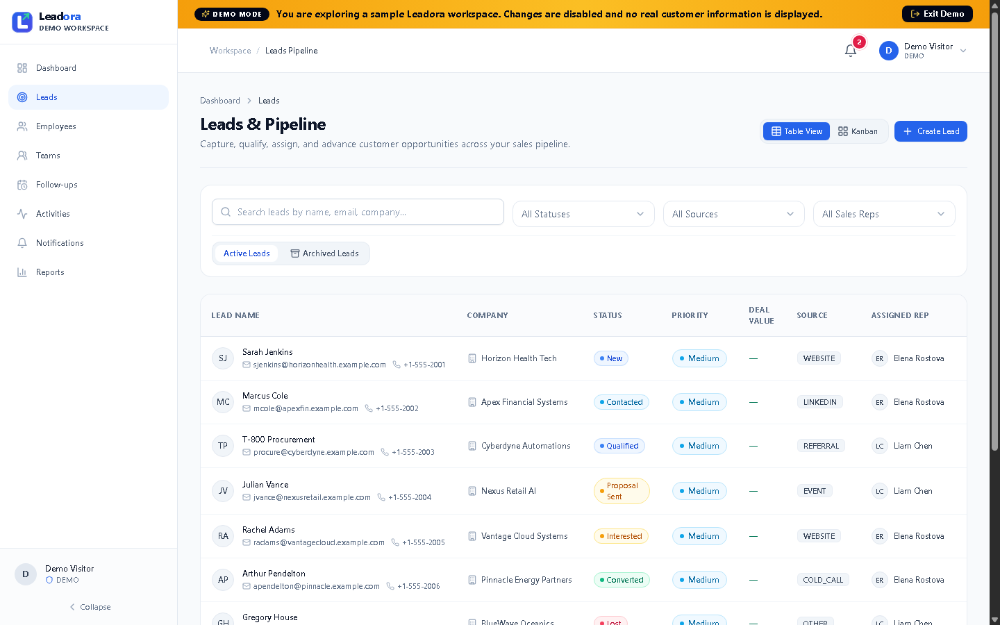
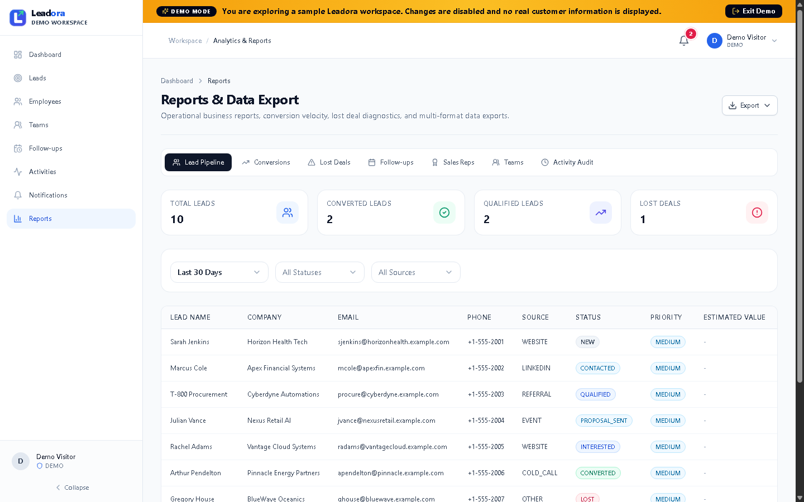
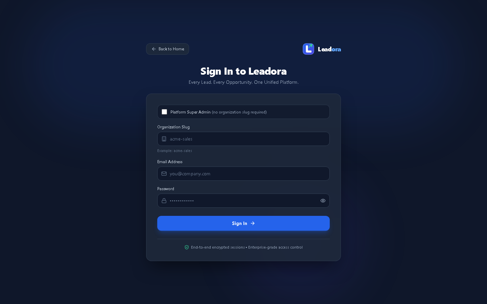

# Leadora — Business CRM & Lead Management SaaS

<p align="center">
  
</p>

<p align="center">
  Every Lead. Every Opportunity. One Platform.
</p>

<p align="center">
  A modern multi-tenant CRM platform designed to help businesses manage leads, organize sales teams, track follow-ups, and monitor performance.
</p>

<p align="center">
  <a href="https://leadora-18.vercel.app">Live Application</a> ·
  <a href="https://leadora-18.vercel.app/demo">Explore Demo</a>
</p>

<p align="center">
  
  
  
  
  
  
  
</p>

<br>

## 🚀 Interactive Product Showcase

<p align="center">
  <a href="https://leadora-18.vercel.app/demo" target="_blank" rel="noopener noreferrer">
    
  </a>
</p>

<p align="center">
  <em>⚡ Click the showcase above to launch the <strong><a href="https://leadora-18.vercel.app/demo">Live Interactive Demo</a></strong> (no sign-in required).</em>
</p>

<br>

## 📸 Product Preview

### 1. Landing Page

A modern public-facing landing page introducing Leadora's capabilities, features, and platform access.

<p align="center">
  
</p>

### 2. Sales Pipeline — Kanban Board

Track leads through the seven-stage sales lifecycle with drag-and-drop interactions and controlled stage transitions.

<p align="center">
  
</p>

### 3. Executive Dashboard

Monitor business performance through KPI cards, pipeline analytics, conversion trends, follow-up health, and team performance.

<p align="center">
  
</p>

### 4. Leads Management

Manage customer prospects using searchable tables, filters, assignments, priority indicators, and lead status tracking.

<p align="center">
  
</p>

### 5. Reports & Data Export

Generate business reports and export structured data in CSV, Excel, and PDF formats.

<p align="center">
  
</p>

### 6. Authentication & Security

A protected login experience with secure session management and role-based access control.

<p align="center">
  
</p>

<br>

## ✨ Key Features

| Feature | Description |
|---|---|
| Multi-Tenant Architecture | Isolated organization data and access boundaries |
| Role-Based Access Control | Super Admin, Admin, Manager, and Employee roles |
| Lead Management | Create, update, assign, filter, and track leads |
| Sales Kanban | Visual seven-stage lead pipeline |
| Follow-up Scheduling | Schedule, manage, and complete follow-up tasks |
| Team Management | Organize employees and sales teams |
| Dashboard & Analytics | Track KPIs, conversions, and team performance |
| Reports & Exports | Generate CSV, Excel, and PDF reports |
| Activity Feed | Maintain a history of important CRM events |
| Notifications | In-app notifications with real-time SSE updates |
| Demo Workspace | Interactive, read-only product demonstration |
| Localization | Organization-level currency and timezone formatting |


<br>

## 🏛️ Architecture & Project Structure

Leadora follows a modular monorepo architecture with a layered backend design.

```text
Leadora/
├── apps/
│   ├── api/
│   │   ├── src/
│   │   │   ├── config/
│   │   │   ├── database/
│   │   │   ├── middleware/
│   │   │   ├── modules/
│   │   │   └── server.js
│   │   └── tests/
│   │
│   └── web/
│       ├── public/
│       │   └── brand/
│       └── src/
│           ├── components/
│           ├── features/
│           ├── pages/
│           └── services/
│
├── docs/
│   ├── api/
│   ├── architecture/
│   ├── assets/
│   ├── database/
│   ├── features/
│   ├── frontend/
│   ├── operations/
│   └── security/
│
├── infrastructure/
│   └── docker/
│
├── .env.example
├── package.json
└── README.md
```

<br>

## 🛡️ Security & Reliability

- **Multi-Tenant Isolation:** Organization-scoped database queries and tenant-aware constraints.
- **Secure Authentication:** JWT-based authentication with HttpOnly cookies.
- **Password Protection:** Argon2 password hashing.
- **Role-Based Authorization:** Access permissions enforced on the backend.
- **Parameterized SQL:** Protects database operations against SQL injection.
- **Atomic Transactions:** Critical operations, including employee workload reassignment, use database transactions.
- **Real-Time Notifications:** Server-Sent Events with an Nginx configuration supporting streaming.
- **Read-Only Demo:** Backend-enforced restrictions protect the demonstration workspace.

<br>

## 🧪 Testing & Code Quality

The backend includes automated tests covering authentication, authorization, tenant isolation, and core business workflows.

```bash
# Run lint checks
npm run lint

# Run backend tests
npm --workspace=apps/api test

# Build the frontend
npm run build:web
```

**Latest reported test results:** 166 passing tests across 13 test suites.

<br>

## ⚙️ Getting Started

### Prerequisites

- Node.js
- npm
- Docker Desktop
- Git

### 1. Clone the Repository

```bash
git clone https://github.com/iamaadii/Leadora.git

cd Leadora
```

### 2. Install Dependencies

```bash
npm install
```

### 3. Configure Environment Variables

Copy the example environment file and configure the required database, authentication, and application settings.

```bash
cp .env.example .env
```

### 4. Start PostgreSQL

```bash
npm run db:up
```

### 5. Run Database Migrations and Seeds

```bash
npm run db:migrate
npm run db:seed
```

### 6. Start the Application

```bash
npm run dev
```

The application will be available at:

| Service | Local URL |
|---|---|
| Frontend | http://localhost:5173 |
| Backend API | http://localhost:5000 |


<br>

## 👥 User Roles

| Role | Responsibilities |
|---|---|
| Super Admin | Platform-level organization and user governance |
| Admin | Organization, employee, team, and CRM administration |
| Manager | Team-scoped lead and follow-up management |
| Employee | Assigned lead management and personal follow-ups |


---

<p align="center">
  **Leadora — Every Lead. Every Opportunity. One Platform.**
</p>