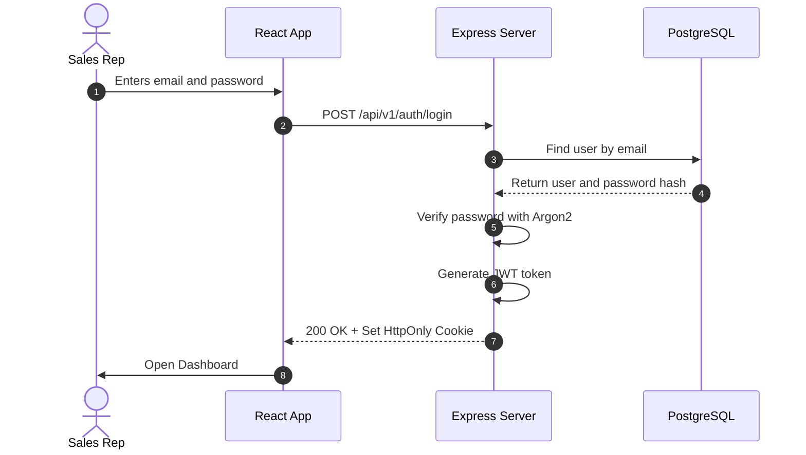
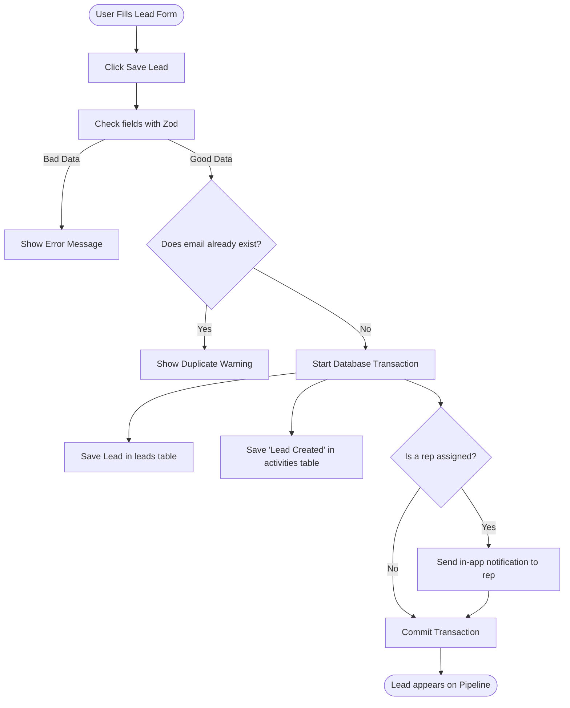

# REST API Design & Complete Reference

This document provides the complete API specification for Leadora, detailing architectural standards, HTTP status codes, workflow diagrams, and full endpoint matrices.

---

## 1. API Standards & Conventions

- **Base URL:** `/api/v1`
- **Content-Type:** `application/json` for all request bodies and responses
- **Authentication:** `HttpOnly`, `SameSite=Lax`, `Secure` (in production) cookies containing a signed JWT
- **Input Validation:** Zod schemas validate, sanitize, and trim all inbound payloads
- **Error Safety:** Database exceptions and stack traces are suppressed in production and masked behind standard error codes

### Standard Success Response Envelope

```json
{
  "success": true,
  "data": {
    "id": "e4b1e5a2-3f82-4e0d-9b5a-1b4e2f8a1c90",
    "name": "Sarah Jenkins",
    "company": "Horizon Media",
    "status": "QUALIFIED"
  },
  "meta": {
    "page": 1,
    "limit": 20,
    "total": 45,
    "totalPages": 3
  }
}
```

### Standard Error Response Envelope

```json
{
  "success": false,
  "error": {
    "code": "VALIDATION_ERROR",
    "message": "Invalid input provided",
    "details": {
      "email": "Please provide a valid email address"
    }
  }
}
```

### HTTP Status Codes

|  Code   | Meaning           | Context                                            |
| :-----: | :---------------- | :------------------------------------------------- |
| **200** | OK                | Standard successful query or update                |
| **201** | Created           | Resource (lead, user, task) created                |
| **204** | No Content        | Resource deleted or soft-deleted                   |
| **400** | Bad Request       | Malformed request syntax or unparseable JSON       |
| **401** | Unauthorized      | Unauthenticated session or expired token           |
| **403** | Forbidden         | Authenticated, but role lacks required permission  |
| **404** | Not Found         | Record does not exist or belongs to another tenant |
| **409** | Conflict          | Unique constraint violation (e.g. duplicate email) |
| **422** | Unprocessable     | Zod schema validation failed on request fields     |
| **429** | Too Many Requests | Rate-limiter triggered by excessive calls          |
| **500** | Internal Error    | Unhandled server error (details masked)            |

---

## 2. Core Application Workflows

### Authentication Flow



### Lead Creation Flow



---

## 3. Complete Endpoint Reference Matrix

### 1. Authentication (`/api/v1/auth`)

| Method  | Endpoint         | Allowed Roles | Description                                                          |
| :------ | :--------------- | :------------ | :------------------------------------------------------------------- |
| `POST`  | `/auth/login`    | Public        | Log in with email, password, and optional org slug. Sets JWT cookie. |
| `POST`  | `/auth/logout`   | Authenticated | Revoke session and clear cookies.                                    |
| `GET`   | `/auth/me`       | Authenticated | Fetch active user profile, tenant info, and role permissions.        |
| `POST`  | `/auth/refresh`  | Authenticated | Rotate refresh token and issue fresh access token.                   |
| `PATCH` | `/auth/password` | Authenticated | Change current user password (verifies current password).            |

### 2. Leads (`/api/v1/leads`)

| Method  | Endpoint                | Allowed Roles            | Description                                                    |
| :------ | :---------------------- | :----------------------- | :------------------------------------------------------------- |
| `GET`   | `/leads`                | Admin, Manager, Employee | Paginated leads list with stage, search, and assignee filters. |
| `POST`  | `/leads`                | Admin, Manager, Employee | Create a new lead.                                             |
| `GET`   | `/leads/assignees`      | Admin, Manager, Employee | Fetch employees available for lead assignment.                 |
| `GET`   | `/leads/:id`            | Admin, Manager, Employee | Fetch full details for a single lead.                          |
| `PATCH` | `/leads/:id`            | Admin, Manager, Employee | Update lead fields, sales stage, or priority.                  |
| `PATCH` | `/leads/:id/archive`    | Admin                    | Soft-delete a lead (`archived_at = NOW()`).                    |
| `PATCH` | `/leads/:id/restore`    | Admin                    | Restore an archived lead.                                      |
| `GET`   | `/leads/:id/activities` | Admin, Manager, Employee | Timeline of interactions and changes on this lead.             |
| `POST`  | `/leads/:id/activities` | Admin, Manager, Employee | Append manual call log, meeting note, or message.              |
| `GET`   | `/leads/:id/followups`  | Admin, Manager, Employee | Fetch all scheduled follow-ups for this lead.                  |

### 3. Follow-ups & Tasks (`/api/v1/followups`)

| Method  | Endpoint                  | Allowed Roles            | Description                                                 |
| :------ | :------------------------ | :----------------------- | :---------------------------------------------------------- |
| `GET`   | `/followups/summary`      | Admin, Manager, Employee | Counter metrics: total, pending, overdue, and due today.    |
| `GET`   | `/followups`              | Admin, Manager, Employee | List tasks with filters for date range, type, and priority. |
| `POST`  | `/followups`              | Admin, Manager, Employee | Schedule a new call, email, meeting, or task.               |
| `GET`   | `/followups/:id`          | Admin, Manager, Employee | Fetch single follow-up details.                             |
| `PATCH` | `/followups/:id`          | Admin, Manager, Employee | Reschedule or edit task details.                            |
| `PATCH` | `/followups/:id/complete` | Admin, Manager, Employee | Mark task completed with mandatory outcome notes.           |
| `PATCH` | `/followups/:id/cancel`   | Admin, Manager, Employee | Cancel task with optional cancellation note.                |
| `GET`   | `/followups/lead/:leadId` | Admin, Manager, Employee | Fetch all tasks associated with a lead ID.                  |

### 4. Employees & Directory (`/api/v1/employees`)

| Method  | Endpoint                    | Allowed Roles | Description                                                |
| :------ | :-------------------------- | :------------ | :--------------------------------------------------------- |
| `GET`   | `/employees`                | Admin         | List tenant employees with active lead counts and teams.   |
| `POST`  | `/employees`                | Admin         | Provision a new employee with temporary password.          |
| `GET`   | `/employees/:id`            | Admin         | Fetch employee details.                                    |
| `PATCH` | `/employees/:id`            | Admin         | Update employee profile information.                       |
| `PATCH` | `/employees/:id/role`       | Admin         | Change role (`ADMIN`, `MANAGER`, `EMPLOYEE`).              |
| `PATCH` | `/employees/:id/deactivate` | Admin         | Deactivate user and terminate active sessions immediately. |
| `PATCH` | `/employees/:id/activate`   | Admin         | Reactivate a suspended employee account.                   |

### 5. Teams (`/api/v1/teams`)

| Method   | Endpoint                         | Allowed Roles  | Description                                        |
| :------- | :------------------------------- | :------------- | :------------------------------------------------- |
| `GET`    | `/teams`                         | Admin, Manager | List sales teams with manager information.         |
| `GET`    | `/teams/my-teams`                | Admin, Manager | List teams managed by the current user.            |
| `POST`   | `/teams`                         | Admin          | Create a new team and designate a manager.         |
| `GET`    | `/teams/:id`                     | Admin, Manager | Fetch team details.                                |
| `PATCH`  | `/teams/:id`                     | Admin          | Update team name or assigned manager.              |
| `PATCH`  | `/teams/:id/deactivate`          | Admin          | Deactivate a team.                                 |
| `PATCH`  | `/teams/:id/activate`            | Admin          | Reactivate a deactivated team.                     |
| `POST`   | `/teams/:id/members`             | Admin          | Add an employee to the team.                       |
| `DELETE` | `/teams/:id/members/:employeeId` | Admin          | Remove an employee from the team.                  |
| `GET`    | `/teams/:id/roster`              | Admin, Manager | Fetch complete member roster for a team.           |
| `GET`    | `/teams/:id/workload`            | Admin, Manager | Review lead workload distribution per team member. |

### 6. Dashboard & Analytics (`/api/v1/dashboard`)

| Method | Endpoint                          | Allowed Roles            | Description                                                 |
| :----- | :-------------------------------- | :----------------------- | :---------------------------------------------------------- |
| `GET`  | `/dashboard/overview`             | Admin, Manager, Employee | Summary KPI cards (Pipeline Value, Active Leads, Win Rate). |
| `GET`  | `/dashboard/lead-pipeline`        | Admin, Manager, Employee | Lead count and dollar value breakdown across 7 stages.      |
| `GET`  | `/dashboard/lead-trends`          | Admin, Manager, Employee | New lead volume over time (day, week, month).               |
| `GET`  | `/dashboard/followup-analytics`   | Admin, Manager, Employee | Follow-up completion rates and category distribution.       |
| `GET`  | `/dashboard/team-performance`     | Admin, Manager           | Compare win rates and lead volume across sales teams.       |
| `GET`  | `/dashboard/employee-performance` | Admin, Manager           | Compare individual rep velocity and won deals.              |
| `GET`  | `/dashboard/recent-activity`      | Admin, Manager, Employee | Feed of recent calls, stage updates, and touchpoints.       |

### 7. Reports & Data Exports (`/api/v1/reports`)

| Method | Endpoint                      | Allowed Roles            | Description                                                             |
| :----- | :---------------------------- | :----------------------- | :---------------------------------------------------------------------- |
| `GET`  | `/reports/:reportType`        | Admin, Manager, Employee | Preview report on screen (`leads`, `conversions`, `lost`, `followups`). |
| `GET`  | `/reports/:reportType/export` | Admin, Manager, Employee | Stream download as `csv`, `excel` (.xlsx), or `pdf`.                    |
| `POST` | `/reports/:reportType/export` | Admin, Manager, Employee | Stream download with custom query parameters.                           |

### 8. Notifications (`/api/v1/notifications`)

| Method  | Endpoint                      | Allowed Roles            | Description                                             |
| :------ | :---------------------------- | :----------------------- | :------------------------------------------------------ |
| `GET`   | `/notifications`              | Admin, Manager, Employee | Paginated notification list.                            |
| `GET`   | `/notifications/unread-count` | Admin, Manager, Employee | Real-time counter of unread alerts for navigation bell. |
| `GET`   | `/notifications/stream`       | Admin, Manager, Employee | Server-Sent Events (SSE) persistent stream.             |
| `PATCH` | `/notifications/:id/read`     | Admin, Manager, Employee | Mark single notification as read.                       |
| `PATCH` | `/notifications/read-all`     | Admin, Manager, Employee | Mark all notifications read.                            |

### 9. Organization Settings (`/api/v1/organization/settings`)

| Method  | Endpoint                 | Allowed Roles            | Description                                      |
| :------ | :----------------------- | :----------------------- | :----------------------------------------------- |
| `GET`   | `/organization/settings` | Admin, Manager, Employee | Fetch company name, currency code, and timezone. |
| `PATCH` | `/organization/settings` | Admin                    | Update organization settings.                    |

### 10. Platform Super Admin (`/api/v1/platform`)

| Method  | Endpoint                             | Allowed Roles | Description                                        |
| :------ | :----------------------------------- | :------------ | :------------------------------------------------- |
| `GET`   | `/platform/organizations`            | Super Admin   | List all company workspaces on the platform.       |
| `POST`  | `/platform/organizations`            | Super Admin   | Provision new organization and initial Admin user. |
| `GET`   | `/platform/organizations/:id`        | Super Admin   | Fetch tenant workspace details.                    |
| `PATCH` | `/platform/organizations/:id/status` | Super Admin   | Suspend or reactivate tenant company.              |
| `GET`   | `/platform/reports/organizations`    | Super Admin   | Platform-wide growth and tenant health analytics.  |
