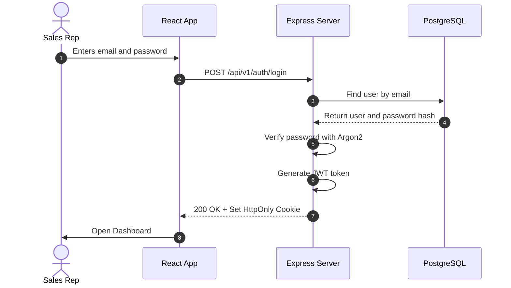
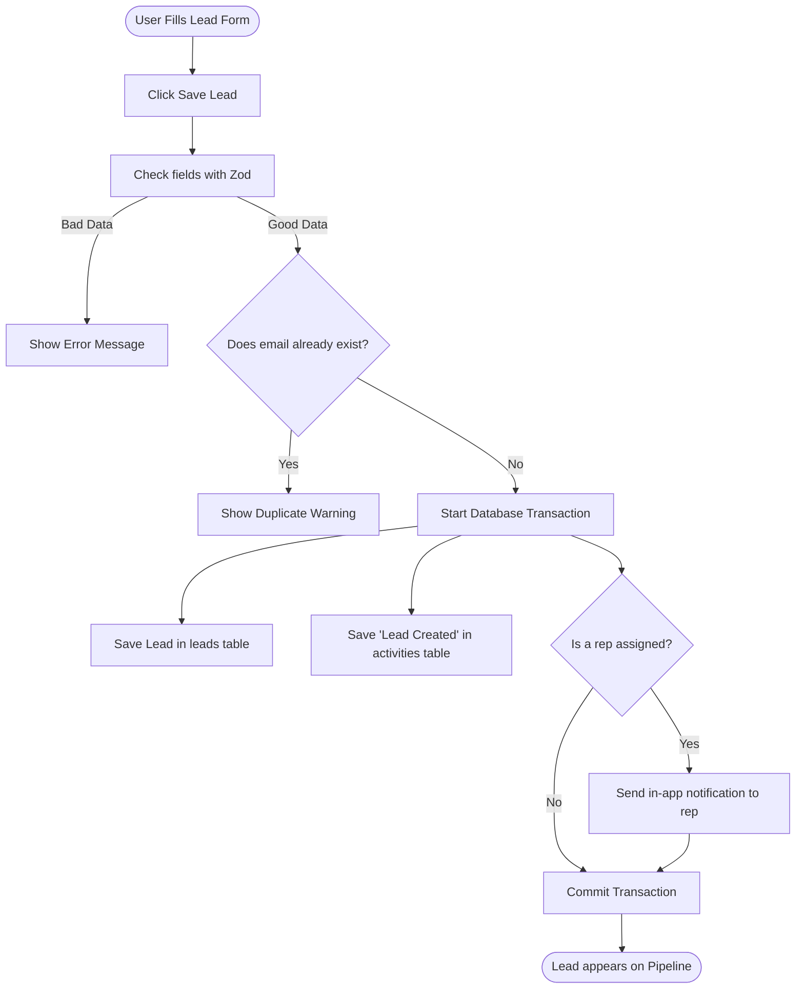

# Application Workflows

This document explains what happens step-by-step during common actions in Leadora.

---

## 1. How Login Works

1. The user types their email and password on the login screen.
2. The server checks the database for the user.
3. The server checks the password using **Argon2**.
4. If correct, the server creates a secure JWT token.
5. The token is sent inside an **HttpOnly cookie**.
6. The user is redirected to their Dashboard.

---

## 2. How Creating a Lead Works

1. The user enters contact name, email, phone, company, and estimated deal value.
2. The server checks the fields with Zod.
3. The database checks if the same email already exists in this company.
4. If clean, the database saves the lead, creates the first activity log, and alerts the assigned sales rep.
5. Everything happens inside one safe transaction.

---

## 3. How the Pipeline Kanban Works

1. The sales rep moves a card from **Contacted** to **Qualified**.
2. The browser immediately moves the card on screen (optimistic update).
3. The server checks that the user has permission to update this lead.
4. The server updates the lead status in the database.
5. An activity log entry (`STATUS_CHANGE`) is automatically created.
6. If the stage is marked **Lost**, the user is asked for a short reason why.

---

## 4. How Follow-up Reminders Work

1. A sales rep schedules a demo for tomorrow at 2:00 PM.
2. The task is saved with status `PENDING`.
3. When the rep logs in tomorrow, the task appears in their **Due Today** queue.
4. If tomorrow passes and the task was not marked complete, it automatically shows an **Overdue** red badge.
5. When the rep finishes the call, they click **Complete** and enter a note.
6. The task status updates to `COMPLETED` and is logged in the lead's history.

