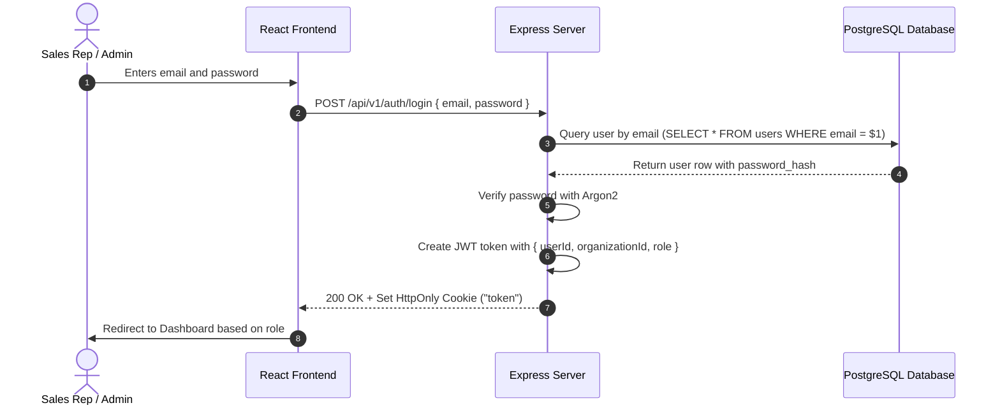
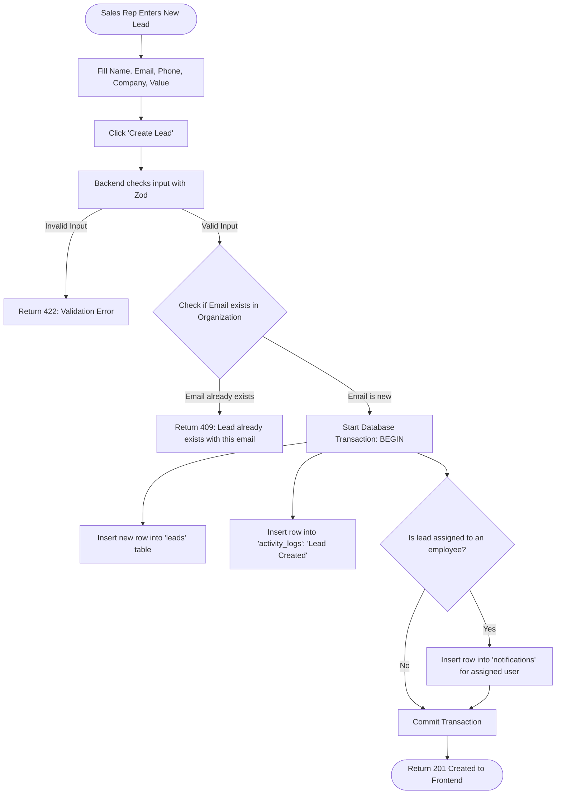
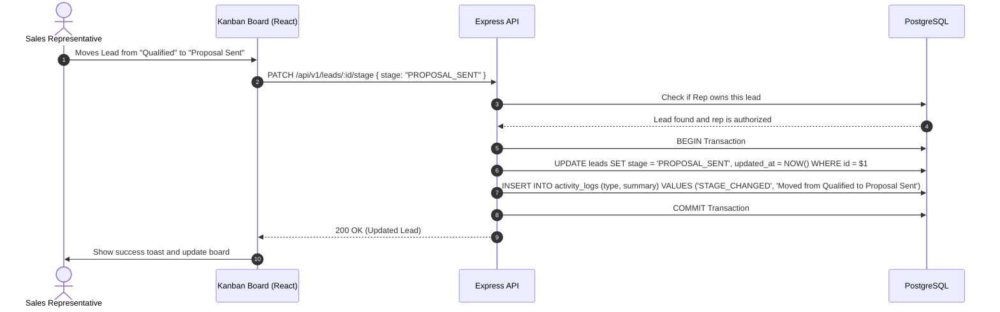
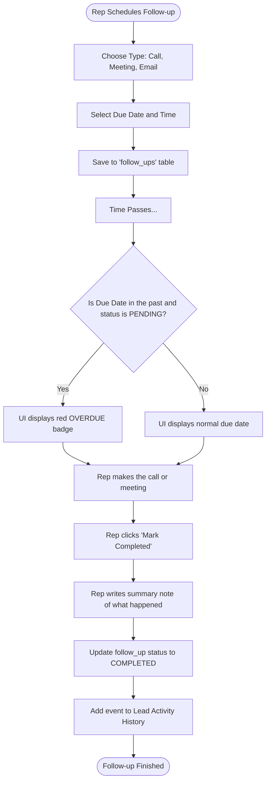

# Application Workflows and User Journeys

## 1. Overview

This document explains step-by-step how users interact with the Business CRM and what happens behind the scenes.

---

## 2. Key User Journeys

### 2.1 Journey 1: User Login and Session Management



**Step-by-step:**
1. The user enters their email and password on the login screen.
2. The frontend sends `POST /api/v1/auth/login` to the backend.
3. The backend runs a parameterized SQL query to find the user.
4. The backend verifies the password using **Argon2**.
5. If valid, the backend generates a signed **JWT** containing the user's `userId`, `organizationId`, and `role`.
6. The backend sends the JWT inside a secure **HttpOnly cookie**.
7. The browser automatically includes this cookie on all future requests. JavaScript in the browser cannot read this cookie, which keeps it safe from hackers.
8. When the user logs out, the server clears the cookie.

---

### 2.2 Journey 2: Lead Creation, Assignment, and Duplicate Check



**Step-by-step:**
1. A sales rep or admin fills in the lead form (Name, Email, Phone, Company, Estimated Value, Source).
2. The backend validates the inputs using **Zod** (checking valid email, phone, positive value).
3. The repository checks if this email already exists in the same company:
   ```sql
   SELECT id FROM leads 
   WHERE organization_id = $1 AND email = $2 AND deleted_at IS NULL;
   ```
4. If a duplicate is found, the user is warned immediately.
5. If clean, the backend runs a **SQL transaction**:
   - `INSERT INTO leads (...) VALUES (...)`
   - `INSERT INTO activity_logs (...) VALUES (...)`
   - If an employee was assigned, `INSERT INTO notifications (...) VALUES (...)`
   - `COMMIT`
6. If any step fails, the transaction rolls back so no incomplete data is saved.

---

### 2.3 Journey 3: Pipeline Kanban Stage Transition

Sales reps manage deals visually by dragging cards between columns (or using a stage dropdown).



**Special rule for "LOST" leads:**
- If the user moves a lead to `LOST`, a popup asks: *"Why did the customer decline?"*
- The reason is saved in `leads.lost_reason` and recorded in the activity timeline.

---

### 2.4 Journey 4: Follow-up Scheduling and Completion



---

### 2.5 Journey 5: Employee Deactivation & Session Revocation

When an employee departs the company or needs to be deactivated:
1. The **Admin** opens the Employees page and clicks **Deactivate User**.
2. Safety validations ensure:
   - The user is not the Admin themselves.
   - The user is not the last active Administrator in the organization.
   - The user is not a Manager leading active teams (must reassign teams first).
3. In a single SQL transaction:
   - User status is marked `is_active = FALSE`.
   - All active refresh tokens are revoked (`revoked_at = NOW()`).
   - Active team memberships are terminated (`removed_at = NOW()`).
   - Audit log entry `DEACTIVATE_EMPLOYEE` is recorded.
4. On the very next request, the user's access token is rejected by authentication middleware.

---

### 2.6 Journey 6: Employee Onboarding & Temporary Password Workflow

1. **Admin Creation**: Admin creates a new employee account with email, name, role (`ADMIN`, `MANAGER`, or `EMPLOYEE`), and temporary password.
2. The user is stored with `must_change_password = TRUE`.
3. Passwords are saved hashed with **Argon2**.
4. When the employee first logs in with their temporary credentials:
   - The frontend identifies `user.must_change_password = true` and prompts a mandatory password change screen before navigating into the CRM.
   - Once updated, `must_change_password` is set to `FALSE`.

---

### 2.7 Journey 7: Team Creation, Membership Assignment & Lead Scoping

1. **Team Creation**: Admin creates a team and assigns an active user with role `MANAGER`.
2. **Member Assignment**: Admin assigns employees (`role = 'EMPLOYEE'`) to the team. The system enforces the single active team membership constraint via PostgreSQL partial unique index `uq_team_members_active_employee`.
3. **Manager Workload Scoping**:
   - The Manager logs in and views `/teams`, which displays only teams they lead.
   - The Manager clicks **View Workload** to see lead counts across all pipeline stages (New, Contacted, Qualified, Proposal, Won, Lost) for each active team member.
4. **Lead Assignment Boundary**:
   - Managers can only assign leads to themselves or active members of their managed teams.
   - If a Manager attempts to assign or view leads outside their teams, the API returns `403 Forbidden` / `404 Not Found`.

