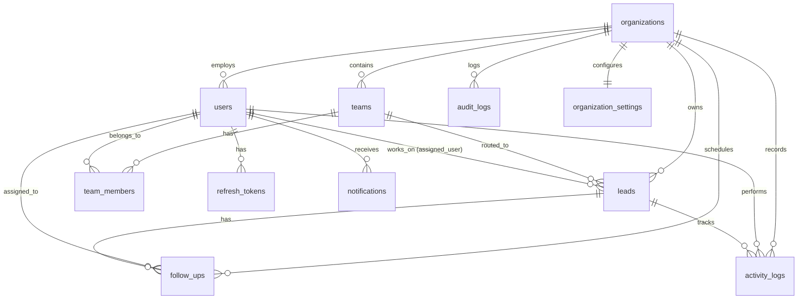

# Database Design and PostgreSQL Schema

## 1. Database Architecture Overview

This application uses **PostgreSQL 16+** as its relational database.
- **Access Method:** Raw SQL queries executed using the official `pg` (`node-postgres`) driver.
- **Migration Method:** Sequential SQL migration files (e.g., `migrations/001_initial_schema.sql`).
- **No ORM:** No Prisma, Sequelize, or Mongoose. All queries are plain, explicit, parameterized SQL queries.

### Key Rules
1. **Multi-Tenancy:** Almost every table contains an `organization_id` foreign key.
2. **Primary Keys:** Every table uses standard `UUID` strings (`gen_random_uuid()`) as primary keys.
3. **Safe Deletions:** Business entities (users, leads, teams) use **soft deletes** with a `deleted_at TIMESTAMPTZ NULL` column.
4. **Append-Only Logs:** Tables like `activity_logs` and `audit_logs` are never updated or deleted.

---

## 2. Entity-Relationship Diagram (ERD)



---

## 3. Database Table Definitions

### 3.1 `organizations`
Stores each customer business.
- `id`: `UUID PRIMARY KEY DEFAULT gen_random_uuid()`
- `name`: `VARCHAR(255) NOT NULL` (e.g. "Acme Corp")
- `slug`: `VARCHAR(100) UNIQUE NOT NULL` (e.g. "acme-corp" for URLs)
- `status`: `VARCHAR(50) DEFAULT 'ACTIVE'` (`ACTIVE`, `SUSPENDED`)
- `created_at`: `TIMESTAMPTZ DEFAULT NOW()`
- `updated_at`: `TIMESTAMPTZ DEFAULT NOW()`
- `deleted_at`: `TIMESTAMPTZ NULL`

### 3.2 `users`
Accounts for all team members across all roles.
- `id`: `UUID PRIMARY KEY DEFAULT gen_random_uuid()`
- `organization_id`: `UUID NULL REFERENCES organizations(id) ON DELETE CASCADE` (NULL only for Super Admin)
- `email`: `VARCHAR(255) NOT NULL`
- `password_hash`: `VARCHAR(255) NOT NULL` (Argon2 hash)
- `first_name`: `VARCHAR(100) NOT NULL`
- `last_name`: `VARCHAR(100) NOT NULL`
- `phone`: `VARCHAR(50) NULL`
- `role`: `VARCHAR(50) NOT NULL` (`SUPER_ADMIN`, `ADMIN`, `MANAGER`, `EMPLOYEE`)
- `status`: `VARCHAR(50) DEFAULT 'ACTIVE'` (`ACTIVE`, `INACTIVE`)
- `created_at`: `TIMESTAMPTZ DEFAULT NOW()`
- `updated_at`: `TIMESTAMPTZ DEFAULT NOW()`
- `deleted_at`: `TIMESTAMPTZ NULL`
- **Unique Constraint:** `UNIQUE (organization_id, email)`

### 3.3 `refresh_tokens`
Stores active session tokens for secure token rotation.
- `id`: `UUID PRIMARY KEY DEFAULT gen_random_uuid()`
- `user_id`: `UUID NOT NULL REFERENCES users(id) ON DELETE CASCADE`
- `token_hash`: `VARCHAR(255) UNIQUE NOT NULL`
- `expires_at`: `TIMESTAMPTZ NOT NULL`
- `created_at`: `TIMESTAMPTZ DEFAULT NOW()`

### 3.4 `teams`
Sales teams inside an organization.
- `id`: `UUID PRIMARY KEY DEFAULT gen_random_uuid()`
- `organization_id`: `UUID NOT NULL REFERENCES organizations(id) ON DELETE CASCADE`
- `name`: `VARCHAR(150) NOT NULL`
- `manager_id`: `UUID NULL REFERENCES users(id) ON DELETE SET NULL`
- `created_at`: `TIMESTAMPTZ DEFAULT NOW()`
- `updated_at`: `TIMESTAMPTZ DEFAULT NOW()`
- `deleted_at`: `TIMESTAMPTZ NULL`

### 3.5 `team_members`
Mapping between users and teams.
- `id`: `UUID PRIMARY KEY DEFAULT gen_random_uuid()`
- `team_id`: `UUID NOT NULL REFERENCES teams(id) ON DELETE CASCADE`
- `user_id`: `UUID NOT NULL REFERENCES users(id) ON DELETE CASCADE`
- `created_at`: `TIMESTAMPTZ DEFAULT NOW()`
- **Unique Constraint:** `UNIQUE (team_id, user_id)`

### 3.6 `leads`
The core business entity representing prospective clients.
- `id`: `UUID PRIMARY KEY DEFAULT gen_random_uuid()`
- `organization_id`: `UUID NOT NULL REFERENCES organizations(id) ON DELETE CASCADE`
- `assigned_user_id`: `UUID NULL REFERENCES users(id) ON DELETE SET NULL`
- `assigned_team_id`: `UUID NULL REFERENCES teams(id) ON DELETE SET NULL`
- `first_name`: `VARCHAR(100) NOT NULL`
- `last_name`: `VARCHAR(100) NOT NULL`
- `email`: `VARCHAR(255) NULL`
- `phone`: `VARCHAR(50) NULL`
- `company_name`: `VARCHAR(200) NULL`
- `job_title`: `VARCHAR(150) NULL`
- `source`: `VARCHAR(50) DEFAULT 'WEBSITE'` (`WEBSITE`, `REFERRAL`, `COLD_CALL`, `EVENT`, `OTHER`)
- `status`: `VARCHAR(50) DEFAULT 'NEW'` (`NEW`, `CONTACTED`, `QUALIFIED`, `PROPOSAL_SENT`, `NEGOTIATION`, `WON`, `LOST`)
- `priority`: `VARCHAR(50) DEFAULT 'MEDIUM'` (`LOW`, `MEDIUM`, `HIGH`)
- `estimated_value`: `DECIMAL(12, 2) DEFAULT 0.00`
- `currency`: `VARCHAR(3) DEFAULT 'USD'`
- `lost_reason`: `TEXT NULL`
- `created_at`: `TIMESTAMPTZ DEFAULT NOW()`
- `updated_at`: `TIMESTAMPTZ DEFAULT NOW()`
- `closed_at`: `TIMESTAMPTZ NULL`
- `deleted_at`: `TIMESTAMPTZ NULL`

### 3.7 `follow_ups`
Tasks, phone calls, meetings, or emails scheduled for a lead.
- `id`: `UUID PRIMARY KEY DEFAULT gen_random_uuid()`
- `organization_id`: `UUID NOT NULL REFERENCES organizations(id) ON DELETE CASCADE`
- `lead_id`: `UUID NOT NULL REFERENCES leads(id) ON DELETE CASCADE`
- `assigned_to_id`: `UUID NOT NULL REFERENCES users(id) ON DELETE CASCADE`
- `created_by_id`: `UUID NOT NULL REFERENCES users(id) ON DELETE CASCADE`
- `title`: `VARCHAR(255) NOT NULL`
- `notes`: `TEXT NULL`
- `task_type`: `VARCHAR(50) DEFAULT 'CALL'` (`CALL`, `EMAIL`, `MEETING`, `DEMO`, `TODO`)
- `priority`: `VARCHAR(50) DEFAULT 'MEDIUM'` (`LOW`, `MEDIUM`, `HIGH`)
- `status`: `VARCHAR(50) DEFAULT 'PENDING'` (`PENDING`, `COMPLETED`, `CANCELLED`)
- `due_date`: `TIMESTAMPTZ NOT NULL`
- `completed_at`: `TIMESTAMPTZ NULL`
- `created_at`: `TIMESTAMPTZ DEFAULT NOW()`
- `updated_at`: `TIMESTAMPTZ DEFAULT NOW()`

### 3.8 `activity_logs`
Chronological timeline of everything that happened to a lead.
- `id`: `UUID PRIMARY KEY DEFAULT gen_random_uuid()`
- `organization_id`: `UUID NOT NULL REFERENCES organizations(id) ON DELETE CASCADE`
- `lead_id`: `UUID NOT NULL REFERENCES leads(id) ON DELETE CASCADE`
- `user_id`: `UUID NULL REFERENCES users(id) ON DELETE SET NULL`
- `type`: `VARCHAR(50) NOT NULL` (`LEAD_CREATED`, `STAGE_CHANGED`, `REASSIGNED`, `NOTE_ADDED`, `FOLLOW_UP_DONE`)
- `summary`: `VARCHAR(255) NOT NULL`
- `details`: `JSONB DEFAULT '{}'::jsonb` (captures old vs new value)
- `created_at`: `TIMESTAMPTZ DEFAULT NOW()`

### 3.9 `notifications`
In-app alerts for users.
- `id`: `UUID PRIMARY KEY DEFAULT gen_random_uuid()`
- `organization_id`: `UUID NOT NULL REFERENCES organizations(id) ON DELETE CASCADE`
- `user_id`: `UUID NOT NULL REFERENCES users(id) ON DELETE CASCADE`
- `title`: `VARCHAR(255) NOT NULL`
- `message`: `TEXT NOT NULL`
- `link`: `VARCHAR(255) NULL` (e.g. `/leads/uuid`)
- `is_read`: `BOOLEAN DEFAULT FALSE`
- `created_at`: `TIMESTAMPTZ DEFAULT NOW()`

### 3.10 `audit_logs`
Security and administrative trail (who logged in, who deleted what).
- `id`: `UUID PRIMARY KEY DEFAULT gen_random_uuid()`
- `organization_id`: `UUID NULL REFERENCES organizations(id) ON DELETE CASCADE`
- `actor_id`: `UUID NULL REFERENCES users(id) ON DELETE SET NULL`
- `action`: `VARCHAR(100) NOT NULL` (e.g. `LOGIN_SUCCESS`, `USER_DEACTIVATED`, `LEAD_DELETED`)
- `details`: `JSONB DEFAULT '{}'::jsonb`
- `ip_address`: `VARCHAR(45) NULL`
- `created_at`: `TIMESTAMPTZ DEFAULT NOW()`

### 3.11 `organization_settings`
Settings for a customer company.
- `id`: `UUID PRIMARY KEY DEFAULT gen_random_uuid()`
- `organization_id`: `UUID UNIQUE NOT NULL REFERENCES organizations(id) ON DELETE CASCADE`
- `default_currency`: `VARCHAR(3) DEFAULT 'USD'`
- `timezone`: `VARCHAR(100) DEFAULT 'UTC'`
- `updated_at`: `TIMESTAMPTZ DEFAULT NOW()`

---

## 4. Complete SQL Migration Script (`001_initial_schema.sql`)

Below is the complete, valid SQL script that creates all tables, primary keys, foreign keys, and indexes:

```sql
-- Enable standard UUID generation
CREATE EXTENSION IF NOT EXISTS "pgcrypto";

-- 1. Organizations
CREATE TABLE organizations (
    id UUID PRIMARY KEY DEFAULT gen_random_uuid(),
    name VARCHAR(255) NOT NULL,
    slug VARCHAR(100) UNIQUE NOT NULL,
    status VARCHAR(50) DEFAULT 'ACTIVE' NOT NULL,
    created_at TIMESTAMPTZ DEFAULT NOW() NOT NULL,
    updated_at TIMESTAMPTZ DEFAULT NOW() NOT NULL,
    deleted_at TIMESTAMPTZ NULL
);

-- 2. Users
CREATE TABLE users (
    id UUID PRIMARY KEY DEFAULT gen_random_uuid(),
    organization_id UUID NULL REFERENCES organizations(id) ON DELETE CASCADE,
    email VARCHAR(255) NOT NULL,
    password_hash VARCHAR(255) NOT NULL,
    first_name VARCHAR(100) NOT NULL,
    last_name VARCHAR(100) NOT NULL,
    phone VARCHAR(50) NULL,
    role VARCHAR(50) NOT NULL,
    status VARCHAR(50) DEFAULT 'ACTIVE' NOT NULL,
    created_at TIMESTAMPTZ DEFAULT NOW() NOT NULL,
    updated_at TIMESTAMPTZ DEFAULT NOW() NOT NULL,
    deleted_at TIMESTAMPTZ NULL,
    CONSTRAINT uq_users_org_email UNIQUE (organization_id, email)
);

-- 3. Refresh Tokens
CREATE TABLE refresh_tokens (
    id UUID PRIMARY KEY DEFAULT gen_random_uuid(),
    user_id UUID NOT NULL REFERENCES users(id) ON DELETE CASCADE,
    token_hash VARCHAR(255) UNIQUE NOT NULL,
    expires_at TIMESTAMPTZ NOT NULL,
    created_at TIMESTAMPTZ DEFAULT NOW() NOT NULL
);

-- 4. Teams
CREATE TABLE teams (
    id UUID PRIMARY KEY DEFAULT gen_random_uuid(),
    organization_id UUID NOT NULL REFERENCES organizations(id) ON DELETE CASCADE,
    name VARCHAR(150) NOT NULL,
    manager_id UUID NULL REFERENCES users(id) ON DELETE SET NULL,
    created_at TIMESTAMPTZ DEFAULT NOW() NOT NULL,
    updated_at TIMESTAMPTZ DEFAULT NOW() NOT NULL,
    deleted_at TIMESTAMPTZ NULL
);

-- 5. Team Members
CREATE TABLE team_members (
    id UUID PRIMARY KEY DEFAULT gen_random_uuid(),
    team_id UUID NOT NULL REFERENCES teams(id) ON DELETE CASCADE,
    user_id UUID NOT NULL REFERENCES users(id) ON DELETE CASCADE,
    created_at TIMESTAMPTZ DEFAULT NOW() NOT NULL,
    CONSTRAINT uq_team_members UNIQUE (team_id, user_id)
);

-- 6. Leads
CREATE TABLE leads (
    id UUID PRIMARY KEY DEFAULT gen_random_uuid(),
    organization_id UUID NOT NULL REFERENCES organizations(id) ON DELETE CASCADE,
    assigned_user_id UUID NULL REFERENCES users(id) ON DELETE SET NULL,
    assigned_team_id UUID NULL REFERENCES teams(id) ON DELETE SET NULL,
    first_name VARCHAR(100) NOT NULL,
    last_name VARCHAR(100) NOT NULL,
    email VARCHAR(255) NULL,
    phone VARCHAR(50) NULL,
    company_name VARCHAR(200) NULL,
    job_title VARCHAR(150) NULL,
    source VARCHAR(50) DEFAULT 'WEBSITE' NOT NULL,
    status VARCHAR(50) DEFAULT 'NEW' NOT NULL,
    priority VARCHAR(50) DEFAULT 'MEDIUM' NOT NULL,
    estimated_value DECIMAL(12, 2) DEFAULT 0.00 NOT NULL,
    currency VARCHAR(3) DEFAULT 'USD' NOT NULL,
    lost_reason TEXT NULL,
    created_at TIMESTAMPTZ DEFAULT NOW() NOT NULL,
    updated_at TIMESTAMPTZ DEFAULT NOW() NOT NULL,
    closed_at TIMESTAMPTZ NULL,
    deleted_at TIMESTAMPTZ NULL
);

-- 7. Follow Ups
CREATE TABLE follow_ups (
    id UUID PRIMARY KEY DEFAULT gen_random_uuid(),
    organization_id UUID NOT NULL REFERENCES organizations(id) ON DELETE CASCADE,
    lead_id UUID NOT NULL REFERENCES leads(id) ON DELETE CASCADE,
    assigned_to_id UUID NOT NULL REFERENCES users(id) ON DELETE CASCADE,
    created_by_id UUID NOT NULL REFERENCES users(id) ON DELETE CASCADE,
    title VARCHAR(255) NOT NULL,
    notes TEXT NULL,
    task_type VARCHAR(50) DEFAULT 'CALL' NOT NULL,
    priority VARCHAR(50) DEFAULT 'MEDIUM' NOT NULL,
    status VARCHAR(50) DEFAULT 'PENDING' NOT NULL,
    due_date TIMESTAMPTZ NOT NULL,
    completed_at TIMESTAMPTZ NULL,
    created_at TIMESTAMPTZ DEFAULT NOW() NOT NULL,
    updated_at TIMESTAMPTZ DEFAULT NOW() NOT NULL
);

-- 8. Activity Logs
CREATE TABLE activity_logs (
    id UUID PRIMARY KEY DEFAULT gen_random_uuid(),
    organization_id UUID NOT NULL REFERENCES organizations(id) ON DELETE CASCADE,
    lead_id UUID NOT NULL REFERENCES leads(id) ON DELETE CASCADE,
    user_id UUID NULL REFERENCES users(id) ON DELETE SET NULL,
    type VARCHAR(50) NOT NULL,
    summary VARCHAR(255) NOT NULL,
    details JSONB DEFAULT '{}'::jsonb NOT NULL,
    created_at TIMESTAMPTZ DEFAULT NOW() NOT NULL
);

-- 9. Notifications
CREATE TABLE notifications (
    id UUID PRIMARY KEY DEFAULT gen_random_uuid(),
    organization_id UUID NOT NULL REFERENCES organizations(id) ON DELETE CASCADE,
    user_id UUID NOT NULL REFERENCES users(id) ON DELETE CASCADE,
    title VARCHAR(255) NOT NULL,
    message TEXT NOT NULL,
    link VARCHAR(255) NULL,
    is_read BOOLEAN DEFAULT FALSE NOT NULL,
    created_at TIMESTAMPTZ DEFAULT NOW() NOT NULL
);

-- 10. Audit Logs
CREATE TABLE audit_logs (
    id UUID PRIMARY KEY DEFAULT gen_random_uuid(),
    organization_id UUID NULL REFERENCES organizations(id) ON DELETE CASCADE,
    actor_id UUID NULL REFERENCES users(id) ON DELETE SET NULL,
    action VARCHAR(100) NOT NULL,
    details JSONB DEFAULT '{}'::jsonb NOT NULL,
    ip_address VARCHAR(45) NULL,
    created_at TIMESTAMPTZ DEFAULT NOW() NOT NULL
);

-- 11. Organization Settings
CREATE TABLE organization_settings (
    id UUID PRIMARY KEY DEFAULT gen_random_uuid(),
    organization_id UUID UNIQUE NOT NULL REFERENCES organizations(id) ON DELETE CASCADE,
    default_currency VARCHAR(3) DEFAULT 'USD' NOT NULL,
    timezone VARCHAR(100) DEFAULT 'UTC' NOT NULL,
    updated_at TIMESTAMPTZ DEFAULT NOW() NOT NULL
);

-- Indexes for Fast Query Performance
CREATE INDEX idx_users_org_role ON users(organization_id, role) WHERE deleted_at IS NULL;
CREATE INDEX idx_leads_org_status ON leads(organization_id, status) WHERE deleted_at IS NULL;
CREATE INDEX idx_leads_org_assigned ON leads(organization_id, assigned_user_id) WHERE deleted_at IS NULL;
CREATE INDEX idx_followups_org_assigned ON follow_ups(organization_id, assigned_to_id, status);
CREATE INDEX idx_activity_logs_lead ON activity_logs(lead_id, created_at DESC);
CREATE INDEX idx_notifications_user_unread ON notifications(user_id, is_read) WHERE is_read = FALSE;
CREATE INDEX idx_audit_logs_org ON audit_logs(organization_id, created_at DESC);
```

