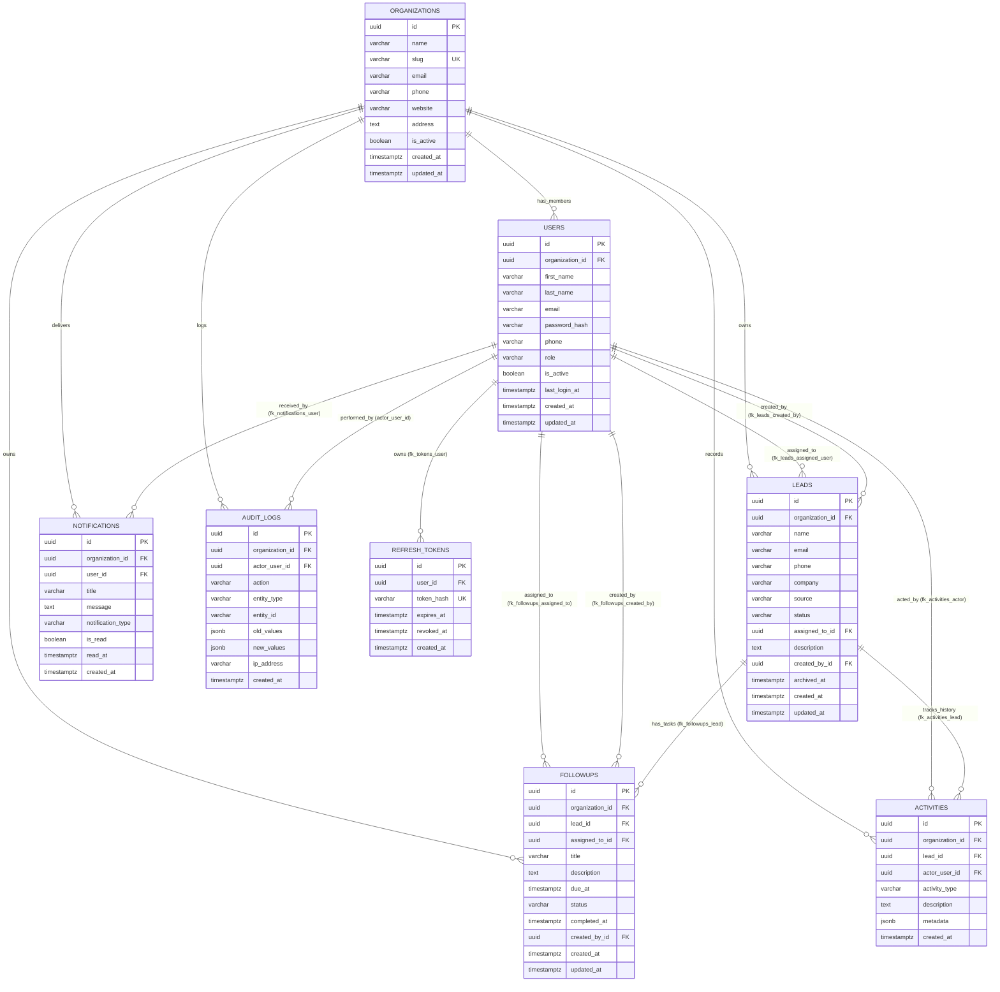

# Database Entity-Relationship Diagram (ERD)

This diagram documents the complete PostgreSQL relational schema implemented in Phase 2 for the **Business CRM & Lead Management System**.

---

---

## Multi-Tenant Referential Integrity Feature

A critical design achievement in this schema is **Composite Foreign Key Isolation**:
- `leads` references `(organization_id, assigned_to_id)` -> `users(organization_id, id)`
- `followups` references `(organization_id, lead_id)` -> `leads(organization_id, id)`
- `followups` references `(organization_id, assigned_to_id)` -> `users(organization_id, id)`
- `activities` references `(organization_id, lead_id)` -> `leads(organization_id, id)`

This guarantees that a lead or follow-up can **never** be associated with a user or entity from a different organization, enforced directly by PostgreSQL engine constraints.
