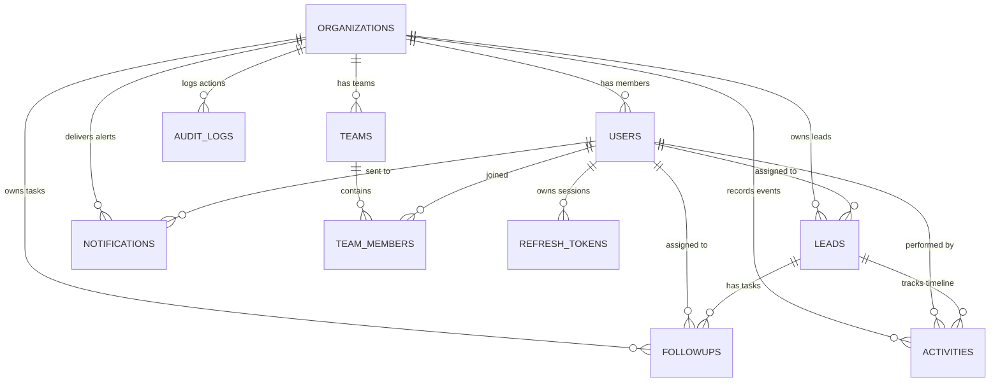

# Database Design, Schema & Operations Guide

This document is the complete reference for Leadora's PostgreSQL database architecture, schema definitions, ERD, and backup/restore procedures.

---

## 1. Database Overview

- **Engine:** PostgreSQL 16+
- **Database Driver:** `pg` (node-postgres) with connection pooling
- **Architecture:** Zero ORM overhead. Direct parameterized SQL (`$1, $2`) for full performance and complete SQL injection immunity.
- **Migration Engine:** Sequential versioned SQL scripts (`001` through `012`) tracked in `schema_migrations`.

---

## 2. Multi-Tenant Schema Design

Data isolation is guaranteed at the database engine level:

1. Every customer-facing table includes `organization_id UUID NOT NULL`.
2. Composite foreign keys `FOREIGN KEY (organization_id, ...) REFERENCES ... (organization_id, ...)` prevent cross-tenant record linking.
3. PostgreSQL transactions execute all multi-table mutations atomically with `withTransaction(client)`.

---

## 3. The 10 Core Tables

### 1. `organizations`

Stores tenant company profiles.

- `id`: `UUID PRIMARY KEY DEFAULT gen_random_uuid()`
- `name`: `VARCHAR(255) NOT NULL` (e.g., "Acme Sales Corp")
- `slug`: `VARCHAR(100) UNIQUE NOT NULL` (e.g., "acme-sales")
- `currency`: `VARCHAR(10) DEFAULT 'USD'`
- `timezone`: `VARCHAR(50) DEFAULT 'UTC'`
- `is_active`: `BOOLEAN DEFAULT true`

### 2. `users`

User credentials and system roles.

- `id`: `UUID PRIMARY KEY DEFAULT gen_random_uuid()`
- `organization_id`: `UUID NULL REFERENCES organizations(id) ON DELETE CASCADE` (NULL solely for `SUPER_ADMIN`)
- `first_name`, `last_name`: `VARCHAR(100) NOT NULL`
- `email`: `VARCHAR(255) NOT NULL` (Unique per organization, globally unique for Super Admin)
- `password_hash`: `VARCHAR(255) NOT NULL` (Argon2id hashed)
- `role`: `VARCHAR(50) NOT NULL CHECK (role IN ('SUPER_ADMIN', 'ADMIN', 'MANAGER', 'EMPLOYEE'))`
- `is_active`: `BOOLEAN DEFAULT true`

### 3. `leads`

Sales pipeline opportunities.

- `id`: `UUID PRIMARY KEY DEFAULT gen_random_uuid()`
- `organization_id`: `UUID NOT NULL REFERENCES organizations(id) ON DELETE CASCADE`
- `name`: `VARCHAR(255) NOT NULL`
- `email`: `VARCHAR(255)`
- `phone`: `VARCHAR(50)`
- `company`: `VARCHAR(255)`
- `source`: `VARCHAR(50) DEFAULT 'OTHER' CHECK (source IN ('WEBSITE', 'REFERRAL', 'COLD_CALL', 'EVENT', 'OTHER'))`
- `status`: `VARCHAR(50) DEFAULT 'NEW' CHECK (status IN ('NEW', 'CONTACTED', 'INTERESTED', 'QUALIFIED', 'PROPOSAL_SENT', 'CONVERTED', 'LOST'))`
- `priority`: `VARCHAR(20) DEFAULT 'MEDIUM' CHECK (priority IN ('LOW', 'MEDIUM', 'HIGH', 'URGENT'))`
- `estimated_value`: `NUMERIC(15, 2)`
- `loss_reason`: `VARCHAR(255)` (Mandatory if `status = 'LOST'`)
- `loss_notes`: `TEXT`
- `assigned_to_id`: `UUID REFERENCES users(id) ON DELETE SET NULL`
- `archived_at`: `TIMESTAMPTZ` (Soft delete flag)

### 4. `followups`

Scheduled tasks and reminders.

- `id`: `UUID PRIMARY KEY DEFAULT gen_random_uuid()`
- `organization_id`: `UUID NOT NULL REFERENCES organizations(id) ON DELETE CASCADE`
- `lead_id`: `UUID NOT NULL REFERENCES leads(id) ON DELETE CASCADE`
- `assigned_to_id`: `UUID REFERENCES users(id) ON DELETE SET NULL`
- `title`: `VARCHAR(255) NOT NULL`
- `description`: `TEXT`
- `type`: `VARCHAR(20) DEFAULT 'CALL' CHECK (type IN ('CALL', 'EMAIL', 'MEETING', 'TASK'))`
- `priority`: `VARCHAR(20) DEFAULT 'MEDIUM' CHECK (priority IN ('LOW', 'MEDIUM', 'HIGH'))`
- `due_at`: `TIMESTAMPTZ NOT NULL`
- `status`: `VARCHAR(20) DEFAULT 'PENDING' CHECK (status IN ('PENDING', 'COMPLETED', 'CANCELLED'))`
- `completed_at`: `TIMESTAMPTZ`
- `completed_by_id`: `UUID REFERENCES users(id)`
- `completion_notes`: `TEXT`

### 5. `activities`

Audit timeline of all actions and historical changes on leads.

- `id`: `UUID PRIMARY KEY DEFAULT gen_random_uuid()`
- `organization_id`: `UUID NOT NULL REFERENCES organizations(id) ON DELETE CASCADE`
- `lead_id`: `UUID NOT NULL REFERENCES leads(id) ON DELETE CASCADE`
- `actor_user_id`: `UUID REFERENCES users(id) ON DELETE SET NULL`
- `activity_type`: `VARCHAR(50) NOT NULL` (e.g., `LEAD_CREATED`, `STATUS_CHANGE`, `FOLLOWUP_COMPLETED`, `NOTE`, `CALL`, `EMAIL`)
- `description`: `TEXT NOT NULL`
- `metadata`: `JSONB DEFAULT '{}'::jsonb`
- `created_at`: `TIMESTAMPTZ DEFAULT NOW()`

### 6. `notifications`

In-app and SSE alert feeds.

- `id`: `UUID PRIMARY KEY DEFAULT gen_random_uuid()`
- `organization_id`: `UUID NOT NULL REFERENCES organizations(id) ON DELETE CASCADE`
- `user_id`: `UUID NOT NULL REFERENCES users(id) ON DELETE CASCADE`
- `title`: `VARCHAR(255) NOT NULL`
- `message`: `TEXT NOT NULL`
- `notification_type`: `VARCHAR(50) NOT NULL`
- `is_read`: `BOOLEAN DEFAULT false`
- `read_at`: `TIMESTAMPTZ`

### 7. `teams`

Sales divisions and teams.

- `id`: `UUID PRIMARY KEY DEFAULT gen_random_uuid()`
- `organization_id`: `UUID NOT NULL REFERENCES organizations(id) ON DELETE CASCADE`
- `name`: `VARCHAR(100) NOT NULL`
- `description`: `TEXT`
- `manager_id`: `UUID REFERENCES users(id) ON DELETE SET NULL`
- `is_active`: `BOOLEAN DEFAULT true`

### 8. `team_members`

Association linking employees to teams.

- `id`: `UUID PRIMARY KEY DEFAULT gen_random_uuid()`
- `organization_id`: `UUID NOT NULL REFERENCES organizations(id) ON DELETE CASCADE`
- `team_id`: `UUID NOT NULL REFERENCES teams(id) ON DELETE CASCADE`
- `employee_id`: `UUID NOT NULL REFERENCES users(id) ON DELETE CASCADE`
- `joined_at`: `TIMESTAMPTZ DEFAULT NOW()`
- `removed_at`: `TIMESTAMPTZ`
- Rule: An employee can belong to at most one active team simultaneously.

### 9. `refresh_tokens`

Authenticated session tokens.

- `id`: `UUID PRIMARY KEY DEFAULT gen_random_uuid()`
- `user_id`: `UUID NOT NULL REFERENCES users(id) ON DELETE CASCADE`
- `token_hash`: `VARCHAR(255) NOT NULL`
- `expires_at`: `TIMESTAMPTZ NOT NULL`
- `revoked_at`: `TIMESTAMPTZ`

### 10. `audit_logs`

Platform and tenant security action log.

- `id`: `UUID PRIMARY KEY DEFAULT gen_random_uuid()`
- `organization_id`: `UUID REFERENCES organizations(id) ON DELETE CASCADE`
- `actor_user_id`: `UUID REFERENCES users(id) ON DELETE SET NULL`
- `action`: `VARCHAR(100) NOT NULL`
- `entity_type`: `VARCHAR(50)`
- `entity_id`: `UUID`
- `new_values`: `JSONB`
- `ip_address`: `VARCHAR(45)`
- `created_at`: `TIMESTAMPTZ DEFAULT NOW()`

---

## 4. Entity-Relationship Diagram (ERD)



---

## 5. SQL Migrations Reference

Migrations are located in `apps/api/src/database/migrations/`:

- `001_create_organizations.sql`: Tenant workspaces table
- `002_create_users.sql`: User credentials and roles
- `003_create_leads.sql`: Sales opportunities and stages
- `004_create_followups.sql`: Task reminders and due dates
- `005_create_activities.sql`: Historical timeline audit
- `006_create_notifications.sql`: In-app notification center
- `007_create_refresh_tokens.sql`: Secure token rotation sessions
- `008_create_audit_logs.sql`: Security change tracking
- `009_expand_activity_types.sql`: Call/meeting metadata support
- `010_create_teams_and_employee_management.sql`: Teams and member constraints
- `011_enhance_followups.sql`: Completion metadata and task types
- `012_add_settings_and_enhance_notifications.sql`: Timezones, currencies, and notifications

Run migrations via:

```bash
npm --workspace=apps/api run db:migrate
```

---

## 6. Backup & Recovery Runbook

### Quick Backup (pg_dump)

```bash
export PGPASSWORD="crm_secret_password"
pg_dump \
  -h localhost \
  -p 5432 \
  -U crm_admin \
  -F c \
  -b \
  -v \
  -f "crm_backup_$(date +%Y%m%d_%H%M%S).dump" \
  business_crm
```

### Quick Restore (pg_restore)

```bash
export PGPASSWORD="crm_secret_password"
dropdb -h localhost -p 5432 -U crm_admin --if-exists business_crm
createdb -h localhost -p 5432 -U crm_admin business_crm

pg_restore \
  -h localhost \
  -p 5432 \
  -U crm_admin \
  -d business_crm \
  -v \
  "crm_backup_file.dump"
```

### Production Daily Automated Backup Script

Place in `/opt/scripts/backup_crm.sh`:

```bash
#!/usr/bin/env bash
set -e

BACKUP_DIR="/var/backups/postgresql/leadora"
TIMESTAMP=$(date +"%Y%m%d_%H%M%S")
BACKUP_FILE="${BACKUP_DIR}/crm_backup_${TIMESTAMP}.dump"

mkdir -p "${BACKUP_DIR}"

PGPASSWORD="${DB_PASSWORD:-crm_secret_password}" pg_dump \
  -h "${DB_HOST:-localhost}" \
  -p "${DB_PORT:-5432}" \
  -U "${DB_USER:-crm_admin}" \
  -F c -b \
  -f "${BACKUP_FILE}" \
  "${DB_NAME:-business_crm}"

# Retain backups for 30 days
find "${BACKUP_DIR}" -name "crm_backup_*.dump" -mtime +30 -delete
```

Schedule in crontab (`0 2 * * * /opt/scripts/backup_crm.sh`).
