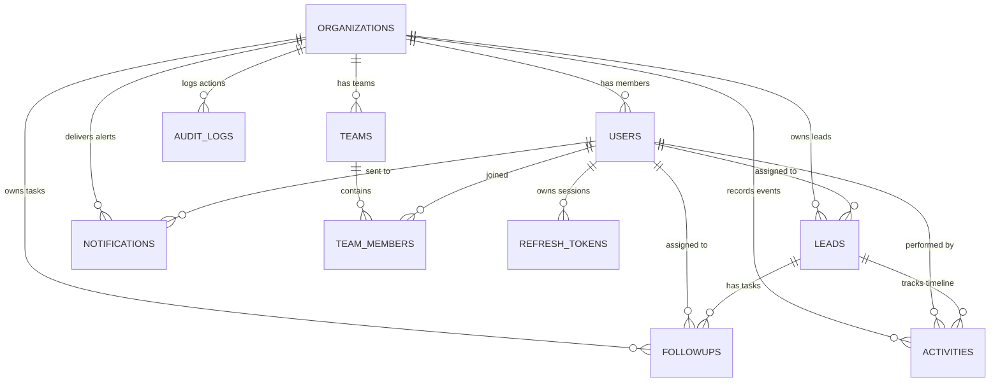

# Database Entity-Relationship Diagram (ERD)

This document shows how the tables in Leadora connect to each other.

---

## 1. Visual Diagram

---

## 2. Table Connections Explained

1. **Organization is the Root:**
   - Every lead, team, follow-up, and activity belongs to one company (`organizations`).
   - If an organization is removed, all of its records are automatically cleaned up.

2. **Teams and Members:**
   - A company has multiple `teams`.
   - Each team has one `manager` (from `users`).
   - Sales reps are linked to teams using `team_members`.

3. **Leads and Follow-ups:**
   - Each lead can have many `followups` (calls, emails, meetings).
   - Each lead has an ongoing `activities` log showing every change made over time.

4. **Security Sessions:**
   - Each logged-in user has `refresh_tokens` saved in the database.
   - When a user logs out, their refresh token is revoked immediately.

